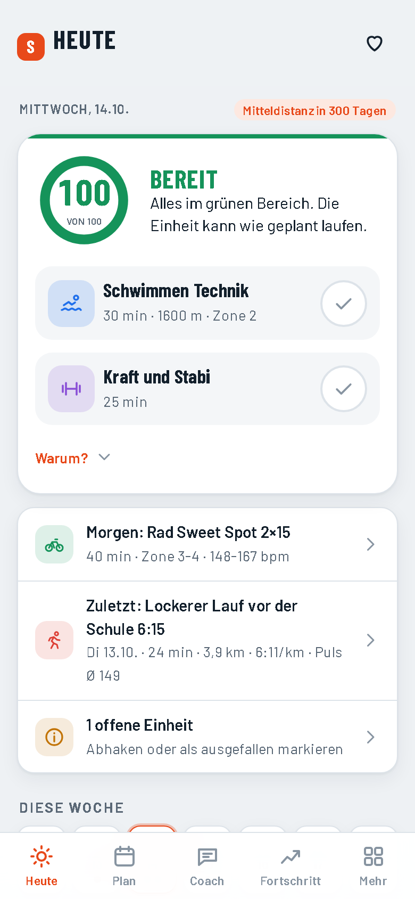
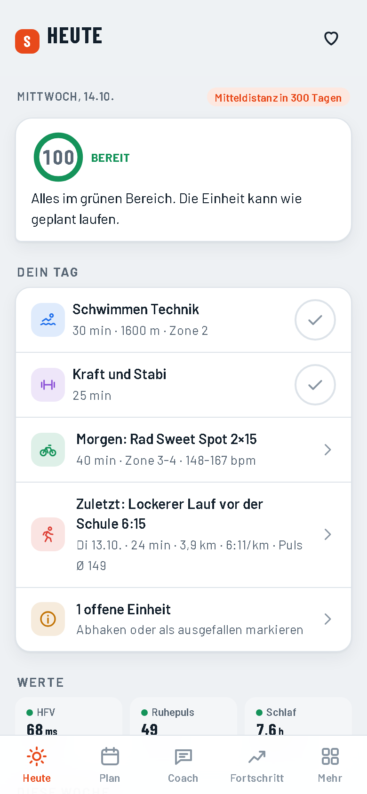

# Design

> Seit Version 3.0.0 (Auftrag 13) gilt das Design „Glas“: Tokens und Regeln in `web/src/design.css` (über `<html data-design="glas">`), Grundbausteine weiter in `web/src/styles.css`. Vergleich der Varianten: `design-varianten.html`.

Stand: 11.10.2026. Bilder: `docs/design/vorher/` (alte App) und `docs/design/nachher/` (neue App). Alle Bilder sind 390 px breit (iPhone), hell und dunkel, mit erfundenen Demo-Daten (`fixtures/demo.mjs`).
Die Bilder werden neu erzeugt mit `npm run build`, `node scripts/test-server.mjs 4180` und `node scripts/screens.mjs`.

## 1. Bestandsaufnahme der alten App

Gemessen mit denselben Demo-Daten (`docs/design/vorher/alt-bericht.json` und `docs/design/nachher/neu-bericht.json`):

| Bildschirm | Höhe alt | Höhe neu | Eingabefelder alt | neu | Wörter alt | neu |
|---|---|---|---|---|---|---|
| Heute | 2062 px | 995 px | 20 | 0 | 194 | 101 |
| Plan | 1746 px | 1347 px | 21 | 0 | 156 | 129 |
| Werte | 3511 px | 2517 px | 17 | 0 | 468 | – |
| Essen | 3423 px | 1862 px | 11 | 2 | 710 | 212 |
| Einstellungen | 3230 px | 2932 px | – | 13 | 388 | 256 |

Was auffiel:
- **Heute war ein Formular.** Unter jeder Einheit standen Uhrzeit- und Notizfelder, dazu die aufklappbaren Morgenwerte. Die Kernfrage „Was mache ich heute?“ ging in Feldern unter.
- **Bewertung aus dem Bauch.** Gut/Okay/Schlecht bei jeder Einheit, die Scores hingen daran.
- **Fünf gleichrangige Tabs**, davon zwei (Werte, Essen), die man nicht täglich braucht. Der Coach hatte keinen eigenen Platz.
- **Export als Text** war der einzige Weg zum Coach (Kopieren, App wechseln, Einfügen).
- **Einstellungen** waren eine lange Seite ohne Gliederung.
- Viele Farben gleichzeitig (Streifen-Kopfzeile, Ampel, Sportfarben, Warnfarben).

## 2. Was ich von anderen Apps übernommen habe

| Vorbild | Muster | Umsetzung |
|---|---|---|
| Oura | **Eine Zahl, ein Satz.** Bereitschaft als Ring, darunter ein Satz in Alltagssprache. | Antwort-Karte auf „Heute“: Ring + Status-Wort + ein Coach-Satz. |
| WHOOP | **„Warum?“ unter jeder Zahl.** Die Beiträge der einzelnen Werte sind aufklappbar. | „Warum?“ auf Heute (HFV, Ruhepuls, Schlaf, 14-Tage-Verlauf) und bei jedem Score. |
| Apple Fitness | **Ruhige Kacheln, Farbe nur für Bedeutung.** Sportfarbe als einziges Farbsignal einer Zeile. | Ein Akzent (Orange), Sportfarben nur im Symbol, Ampelfarben nur für Status. |
| Runna | **Die heutige Einheit ist die Hauptaktion.** Ein Tipp zum Abhaken, Details im Sheet. | Großer Haken direkt in der Antwort-Karte, Details öffnen sich von unten. |
| TrainingPeaks | **Geplant gegen erledigt** in der Woche, Umfang als Balken. | Wochenleiste auf Heute, Umfangsbalken (hell geplant, kräftig erledigt) im Fortschritt. |
| Runna / TrainingPeaks | **Plan-Änderungen mit Grund**, rückgängig machbar. | Anpassungen im Plan mit „Warum“ und „Rückgängig“, Coach-Nachricht zu jeder Änderung. |
| Oura / Apple Health | **Quelle bei jedem Wert.** | Kleines Quellen-Kürzel (OU, HF, ✎ …) neben jedem Messwert, „Auf Original zurücksetzen“. |
| Apple (iOS) | **Sheets statt neuer Seiten** für kurze Aufgaben, Zurück-Pfeil für Unterseiten. | Alle Detail-Aufgaben als Sheet, „Mehr“ führt in Unterseiten mit Zurück. |

## 3. Prinzipien

1. **Heute beantwortet eine Frage:** „Was mache ich heute und wie geht es mir?“ – ohne Tippen sichtbar.
2. **Messen statt fragen.** Werte kommen aus Uhr, Ring und Dateien. Eingeben ist die Ausnahme und bleibt erhalten (✎).
3. **Ein Tipp für das Häufigste:** abhaken. Alles andere höchstens zwei Tipps tief.
4. **Jede Zahl erklärt sich** („Warum?“) und zeigt ihre Quelle.
5. **Der Coach spricht, die App rechnet.** Änderungen erscheinen als Nachricht mit Grund und lassen sich zurücknehmen.
6. **Ruhig:** ein Akzent, Sportfarben nur als Symbol, Ampelfarben nur für Status. Hell und dunkel gleichwertig.
7. **Daumen-Zone:** Tabs unten, Hauptaktionen unten im Sheet, Ziele mindestens 44 px.
8. **Sicherheit vor Ehrgeiz:** Krankheit und Warnzeichen stehen immer oben und sind deutlich.

## 4. Aufbau (5 Tabs)

| Tab | Inhalt |
|---|---|
| **Heute** | Antwort-Karte (Ring, Status, Coach-Satz, Einheiten mit Haken, „Warum?“), Morgen/Zuletzt/Offen, Krankheit/Wiedereinstieg, Wettkampf-Hinweis, Woche, Coach-Vorschau, Essen kurz |
| **Plan** | Wochen-Chips, Tage mit Einheiten, Extra-Einheiten, Anpassungen mit Grund und Rückgängig |
| **Coach** | Nachrichten (Briefing, Kommentare, Wochenrückblick, Vorschläge), Schnellfragen, „Mit Claude besprechen“, Plan-Code, Notizen; KI-Chat, sobald eingeschaltet |
| **Fortschritt** | Gesamt-Form, Score je Sportart mit 6-Wochen-Trend und „Warum?“, Prognose, Umfang, Meilensteine |
| **Mehr** | Werte, Essen, Wettkampf, Profil und Ziele, Verbindungen, Einstellungen, Daten und Geräte, Fragebogen, Plan-Generator (nur Test) |

## 5. Zwei Entwürfe für „Heute“

| | A: Antwort-Karte (gewählt) | B: Tages-Feed |
|---|---|---|
| Bild | `nachher/neu-heute-light.png` | `nachher/neu-heute-feed-light.png` |
| Aufbau | Eine große Karte: Ring, Status, Satz, Einheiten mit Haken | Kleine Status-Nachricht, darunter eine Liste „Dein Tag“ und Werte-Kacheln |
| Höhe | 995 px | 1079 px |
| Stärke | Antwort und Hauptaktion auf einen Blick, sehr ruhig | Alles in einer Liste, Werte sofort sichtbar |
| Schwäche | Werte erst nach „Warum?“ | Status wirkt nebensächlich, mehr Text |

**Entscheidung: A.** Die Frage „Wie geht es mir, was mache ich?“ wird ohne Scrollen und ohne Tippen beantwortet, das Abhaken liegt direkt daneben. B bleibt als Option unter Einstellungen → Darstellung → „Tages-Feed“ (für Leute, die lieber alle Werte sehen).

 

## 6. Tipps für 5 häufige Aufgaben

| Aufgabe | Vorher | Nachher | Wie jetzt |
|---|---|---|---|
| Wie geht es mir heute? | 0 | 0 | Ring und Satz oben auf Heute |
| Was steht morgen an? | 1 | 0 | Zeile „Morgen“ direkt auf Heute |
| Einen Wert einer Einheit korrigieren | 4 | 2 | Einheit antippen → Feld (Sheet) |
| Wochenbericht für den Coach | 3 + App-Wechsel | 0 / 3 | Wochenrückblick kommt sonntags automatisch in den Coach; für Claude: Coach → „Mit Claude besprechen“ → Teilen (direkt ins Teilen-Menü) |
| Wie läuft Schwimmen? | 1 + Scrollen | 1 (2 mit „Warum?“) | Fortschritt: Schwimmen-Kachel oben, Antippen erklärt den Score |

Abhaken bleibt 1 Tipp. Morgenwerte eintragen: 1 Tipp (Herz oben rechts), meistens 0, weil sie automatisch kommen.

## 7. Gestaltung

- **Farben** als Variablen in `web/src/styles.css` (`--bg`, `--surface`, `--ink`, `--accent`, Sportfarben `--swim` …, Status `--good/--warn/--bad`), je für hell und dunkel.
- **Schrift:** Barlow (Text) und Barlow Condensed (Überschriften, Zahlen), lokal eingebunden, offline verfügbar.
- **Abstände:** 4er-Raster (`--s1` … `--s6`), Karten mit 16 px Rand, Ziele ≥ 44 px.
- **Zugänglichkeit:** Haken und Symbole haben `aria-label`, Tabs `aria-current`, Kontraste geprüft für hell und dunkel, Texte über `shared/lang/de.ts` (Englisch vorbereitet).
- **Name und Marke** stehen nur in `shared/brand.ts` (Stamio, Zeichen „S“). Icon und Startbilder: `npm run icons`.
