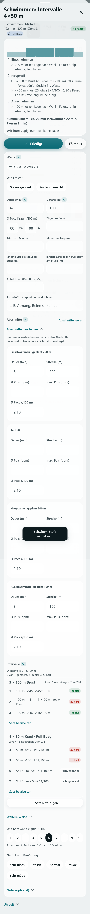
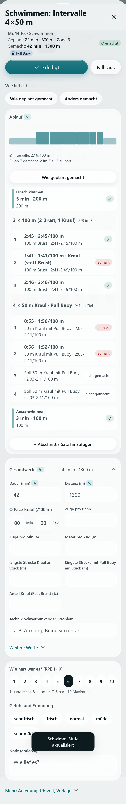

# Auftrag 37: Einheiten übersichtlich – ein Ablauf, Bearbeiten im Fenster, Nachtragen mit Datum (17.11.)

**Stand:** Version **3.25.0**, **veröffentlicht am 18.11.** (alle Tests grün: 3.316 Unit, 796 Browser; erst Test-App, dann echte App; beide vorher gesichert; alle 3 Nutzer laden und starten fehlerfrei; 10 Minuten ohne Startfehler). Beim 1. Release-Lauf gefunden und behoben: Die Uhr meldete eine Schwimm-Bahn mit 0 m als Wiederholung, jetzt zählt sie als Pause (Nr. 599). Die Daten auf dem Server sind dabei unverändert geblieben.

## Was war vorhanden, was war falsch
- Zwei Listen für dasselbe: „Abschnitte“ (Auftrag 35) und „Intervalle“ (Auftrag 36), dazu oben noch einmal die Schritte. Bearbeiten in drei Ebenen (Wiederholung → „Lage, Hilfsmittel …“ → „Satz bearbeiten“).
- **Fehler „alles klappt auf“, Ursache gefunden:** `refreshSheet` (kit.ts) merkte sich offene Bereiche über den Text der Überschrift. Alle gleich lautenden Bereiche gingen nach jeder Änderung auf (nachgestellt: 7 statt 3 offen). Behoben über feste Kennungen – gilt für alle Fenster der App.
- Nachtragen-Liste ohne Datum. Gesamtwerte bei Intervall-Einheiten nur aus Aufwärmen + Ausklang.

## Jetzt
- **Ein Ablauf** je Einheit (alle Sportarten): Aufwärmen → Sätze mit Wiederholungen → Ausklang; Schwimmen mit Einschwimmen/Technik/Ausschwimmen; Kraft: Übungen. Jede Zeile: Ist fett, Soll grau, Urteil (✓, zu hart, zu locker, kürzer, anders, wie geplant). Abweichung sichtbar: „1:41 · 1:41/100 m · Kraul (statt Brust)“, Satz-Kopf „3 × 100 m (2 Brust, 1 Kraul) · 2/3 im Ziel“.
- **Antippen → Fenster nur für diesen Teil** (Satz, Wiederholung, Abschnitt, Übung) mit allen Feldern und Knöpfen; in der Liste klappt nichts mehr auf. Das Diagramm oben öffnet dasselbe Fenster. „+ Abschnitt / Satz hinzufügen“; Aufwärmen/Ausklang ändern, löschen, wieder hinzufügen.
- **Wie geplant gemacht:** füllt den ganzen Ablauf (markiert „wie geplant“, nicht gemessen – zählt nie für Tempo, Scores, Kraul-Tempo). Uhrdaten haben Vorrang.
- **Rückgängig:** nach Löschen, „wie geplant“ und jedem Fenster ein Hinweis mit „Rückgängig“; mehrere Schritte nacheinander (auch „↶ Rückgängig (n)“ oben).
- **Seite:** Kopf (Wochentag + Datum, Geplant/Gemacht, Urteil) → Ablauf → Gesamtwerte (eingeklappt bei Uhr-Daten, jetzt aus dem ganzen Ablauf) → Coach-Bewertung → Gefühl/Notiz → „Mehr“.
- **Nachtragen:** „Mo, 12.10. · Rad locker 60 min“, nach Datum sortiert, je Einheit „Nachtragen“ oder „Nicht gemacht“.
- Gespeichert wird in den bisherigen Feldern: keine Umstellung deiner Daten (Entscheidungen 590–598).

## Bilder (Schwimm-Einheit, iPhone-Breite)
| Vorher (3.24.0) | Nachher (3.25.0) | Fenster einer Wiederholung |
|---|---|---|
|  |  |  |

## Tests
- **Fehler nachgestellt, bevor er behoben wurde:** 1 Wiederholung geändert → 7 Bereiche offen statt 3. Jetzt prüft der Test, dass beim Ändern nichts aufklappt.
- **Neuer Test `auftrag37`** (WebKit iPhone + Chromium, echte Eingabe): Schwimmen 3 × 100 m Brust → 2. auf Kraul → Bewertung gegen das Kraul-Ziel; Pull Buoy und Titel für den Satz; Einschwimmen/Ausschwimmen ändern, löschen, wieder hinzufügen; Gesamtwerte passen zum Ablauf; „Wie geplant gemacht“ + eine Abweichung; Rückgängig (einzeln und mehrere Schritte); Diagramm öffnet dasselbe Fenster; Nachtragen zeigt Datum und öffnet den richtigen Tag; dasselbe für Laufen, Rad, Koppel (Rad + Lauf) und Kraft; Überlauf 320/375/430 px mit großer Schrift für Liste und Fenster.
- **Unit-Tests `ablauf37`** (7): Reihenfolge, Soll/Ist/Urteil, wie geplant zählt nie als Messwert, Uhr hat Vorrang, Gesamtwerte mit Pause, Löschen/Hinzufügen, Kraft.
- **Alte Tests angepasst statt doppelt:** Intervalle (22, 36), Abschnitte (35), km-Ansicht, Kraft, Vorlagen, Extra-Einheiten – gleiche Prüfungen, neuer Weg über das Fenster.
- **Alle Browser-Tests** (~940, beide Browser): grün. 4 Teile parallel (50 min); 69 dort rote Tests waren Überlast bzw. fest eingestellter Port – die 25 Dateien nacheinander wiederholt: 442 grün (28 min).
- **Großer Test: 18:26 min** (Ziel unter 45 min). Simulation 36 Nutzer, 19.292 Tage, 33.703 Aktionen, 0 Fehler; 134 Browser-Abläufe; Typprüfung; alle Unit-Tests. Rot nur unter Last: 3 Push-Server-Tests und 2 WebKit-Starts – einzeln wiederholt grün.

---

# Auftrag 36: Intervalle bearbeiten, Scores, Prognose, große Simulation (16.11.)

**Stand:** Version **3.24.0**, **veröffentlicht am 16.11.** (alle Tests grün; erst Test-App, dann echte App; beide vorher gesichert; alle 3 Nutzer starten fehlerfrei, auch vom alten Stand aus). Beobachtung danach am 17.11. nachgeholt: keine Startfehler seit dem Hochladen (ganze Nacht). Beim 1. Release-Lauf gefunden und behoben: „zusätzlich“ fehlte in der Intervall-Liste, Enter verlor unter Last den Fokus (Nr. 589).

## 1. Intervalle nach dem Training
- **Vorher:** jede Wiederholung eine große Karte (7 Felder + 5 Knöpfe); Titel, Lage, Hilfsmittel nicht änderbar; „4 × 100 m in 1:55“ ohne Pace bekam kein Urteil.
- **Jetzt:** Sätze gruppiert („4 × 100 m Kraul · Pull Buoy“), eine Zeile je Wiederholung (Werte + Urteil), Antippen öffnet die Details. „Ganzer Satz gleich“ (Dauer, Pace/Watt, Puls), einzelne Wiederholungen abweichend. Je Satz bzw. Wiederholung: Titel, Lage (Kraul, Brust, Rücken, Delfin, Lagen, Technikübung, Beine), Hilfsmittel (Pull Buoy, Kickboard, Paddles, Flossen, keine), Zone; Laufen/Rad: Art (bergauf, Fahrtspiel, Steigerung …) und Untergrund. Sätze hinzufügen, löschen, verschieben, Wiederholung hinzufügen.
- **Das Programm versteht es:** Bewertung gegen das tatsächlich Gemachte (Pull-Tempo, Brust-Tempo, andere Zone; bergauf ohne Tempo-Ziel). Kraul mit Pull Buoy zählt nicht als „Kraul am Stück ohne Hilfsmittel“, sondern als „mit Pull Buoy am Stück“ und nur abgeschwächt für die CSS; Kickboard/Beine = Beinarbeit; Flossen nie fürs Kraul-Tempo. Schwimm-Stufen und Bestwerte nutzen das. Coach (Bewertung und KI-Kontext): „Die 4 × 100 m Kraul hast du mit Pull Buoy statt ohne Hilfsmittel geschwommen – zählt nicht als Kraul am Stück …“.
- **Kraft:** „Wie letztes Mal (Datum: 5 Übungen mit Gewichten)“ übernimmt Übungen und Gewichte; Ändern, Tauschen, Hinzufügen gab es schon.

## 2. Scores
**Kraft-Score neu** (vorher nur Regelmäßigkeit; die „Steigerung“ las ein Feld, das nie gefüllt wurde): Regelmäßigkeit 30 %, Umfang je Bereich 20 %, Abdeckung Triathlon 15 % (Beine/Hüfte, einbeinig/Stabilität, Rumpf, Zug, Druck), Steigerung 20 % (Epley, bester Satz, Körpergewicht bei Übungen ohne Gewicht, unter 18 nur ab 6 Wdh., kein Maximaltest), Dauer 15 %. Ohne Übungen: „Nur Regelmäßigkeit bekannt“ + Hinweis (Vorlage oder „Wie letztes Mal“).

| Wert | Ergebnis | Grund |
|---|---|---|
| Effizienz locker | nicht (bleibt angezeigt, 0 %) | hängt stark an Hitze, Müdigkeit, Strecke, Uhr; fließt schon gedämpft in die Schwellen-Schätzung |
| Puls-Erholung in Intervallpausen | nicht | hängt an Pausenlänge und Puls-Verzögerung der Uhr; steht in der Bewertung |
| Umfang/Regelmäßigkeit (Ausdauer) | nicht | steckt in der Gesamt-Form (CTL), sonst doppelt; bei Kraft ja |
| Schritt-/Trittfrequenz | nicht | Stil, kein Leistungsmaß |
| Laufleistung (Watt) | nicht | je Uhr/Sensor anders gerechnet, nicht vergleichbar |
| NP | **aufgenommen** (kein neues Gewicht) | ersetzt Ø-Watt bei harten welligen Fahrten (VI 1,02–1,15) in der FTP-Schätzung; bildet die Belastung besser ab; sehr unruhige Fahrten mit mehr Unsicherheit |
| Höhenmeter-Leistung | nicht | geländeabhängig; Hügel werden schon herausgerechnet |
| Schwimmen mit/ohne Hilfsmittel | **aufgenommen** | Kraul ohne Hilfsmittel voll, Pull Buoy abgeschwächt (+5 s, 4-fache Unsicherheit), Beine/Flossen nie |
| Schwimm-Puls | nicht | Handgelenk-Puls im Wasser unzuverlässig |
| SWOLF | nicht | Mischung aus Zeit und Zügen, doppelt zu CSS und Meter pro Zug |
| Freiwasser | nicht im Score | Bedingungen (Strömung, Neo) zu verschieden; in der Prognose ja |

**Gesamt-Form geprüft:** bleibt Trainingsbelastung (CTL) zum Ziel. Frische (TSB) schwankt täglich und ist je Phase gewollt hoch oder niedrig; Leistungs-Scores stehen getrennt und fließen in die Prognose – beides würde täuschen bzw. doppelt zählen. Neu: „Warum?“ mit CTL je Sportart, TSB und dieser Erklärung.

## 3. Prognose
Geprüft (Test `auftrag36-prognose`, 18 Fälle): Daniels-VDOT-Tabelle (VDOT 30–70, 5 km–Marathon) ±1 %, Riegel 1,06, Schwellen-Pace ≈ T-Pace (±3 %), Rad-Physik (200 W Rennrad 32–35 km/h, 250 W Zeitfahrrad 39–42 km/h), Wechselzeiten, Freiwasser +3 %, Neo −4 bis −6 %, 6 Alters-/Geschlechtsgruppen × 3 Niveaus × 8 Ziele (realistische Bereiche, stärker = schneller, länger = länger). Keine Rechenfehler gefunden. Erklärte Abweichungen:
- Ohne lange Läufe ist der Marathon > 5 % langsamer als Daniels (Riegel-Exponent bis 1,15) – gewollt, Daniels setzt Ausdauer voraus.
- Die Schwelle aus VO2max liegt ~3 % schneller als Daniels' T-Pace (App: Tempo für ~60 min) – innerhalb der Unsicherheit.
- Sprung/Pause/Krankheit: Training mit eigenem Trend ≤ typische Entwicklung < nach 6 Wochen Pause; krank nie schneller; gleiche Werte = gleiche Zeit.

**Dein Fall:** 5:39/km kommt aus lockeren Läufen hochgerechnet („Trend“), nicht gemessen (≈ VDOT 35); VO2max 57 der Uhr passt zu ca. 3:48/km. Jetzt: ehrlicher Hinweis in der Prognose, breiterer Bereich, Lauftest als erster Tipp, und der Coach schlägt vor, eine passende Laufeinheit durch den 30-min-Lauftest zu ersetzen (bei dir: 22.11. statt des langen Laufs). Allgemein für alle Nutzer: über 15 % Abstand oder nur hochgerechnet → Hinweis + Test.

## 4. Plan-Regeln (Daten-Check)
Die gemeldeten Fälle sind behoben, Ursachen im allgemeinen Code:
| Fund | Ursache | Fix |
|---|---|---|
| „Locker nach dem Wettkampf“ (Nutzer 1, 10.11.) | Neu-Planen nach einem Rennen kannte nur künftige Ziele; „Lauf-Qualität vor dem Laufziel“ setzte Intervalle direkt danach | Rennen der letzten 14 Tage zählen; Qualität nie in die lockeren Tage nach einem Rennen |
| „Erholungswoche zu niedrig/hoch“ (Nutzer 2, 5) und „lange Einheit +10 min“ | Bezug war eine gekürzte Woche (Coach, Ampel, Tagesanpassung) oder fiel ganz weg → Rückkehr zum Plan = „Sprung“ | Bezug = geplanter Wert; geplante reduzierte Wochen weiter ohne Bezug |
| Erholungswoche über 78 % | „Stufe wiederholen“ (Kraul lernen) und Schwimm-Stufen-Update setzten in der Erholungswoche wieder die volle Einheit ein | kürzere Dauer bleibt (zwei Stellen) |
| Erholungswoche „32 %“ nach dem Hauptrennen | Vergleich mit einer Aufbauwoche vor dem Rennen | kein Vergleich über ein A/B-Rennen |
| Wettkampfwoche: Intervalle am Montag | „Nachholen“ prüfte die Woche nicht | gleiche Sperre wie der Generator |
| „Nach langem Tag …“, harte Tage | entstanden in der Simulation nur durch eigene Änderungen mit „Trotzdem übernehmen“ | gelten nicht mehr als Plan-Fehler (die Pflege ließ sie schon) |

Echte Daten (Kopie vom 14.11., Stand 16.11.): alle 3 Nutzer laden fehlerfrei, **Daten-Check grün** (0 Befunde). Bei Nutzer 2 meldet die Plan-Pflege 6 Wochen ohne Tempolauf vor dem HM – ehrlich als Lücke markiert (kein freier Lauftag neben Spielen), kein Fehler.

## 5. Großer Test
Ein Aufruf: `node scripts/grosser-test.mjs` (16 Kerne, alles parallel).

| Teil | Dauer |
|---|---|
| Build (einmal) | 0:03 min |
| Typprüfung | 0:13 min |
| Unit-Tests (3 Worker) | 11:53 min |
| Simulation (18 Teile) | 15:07 min |
| Browser (3 Teile, je eigener Server) | 2:38 / 3:41 / 3:54 min |
| **Gesamt** | **15:11 min** (Ziel < 45) |

- **Simulation:** 36 erfundene Nutzer (10 Test-Personen + 26 Daten-Fälle: alle Sportarten und Ziele, 16–64 Jahre, w/m, Teamsport, Uhr bzw. Handeingabe, fleißig bis faul), 12–24 Monate = **19 292 Tage, 33 703 Aktionen** (10 678 erledigt, 4 072 ausgelassen, 806 verschoben, 720 umgewandelt, 1 293 gekürzt, 1 148 anders gemacht, 977 Intervall-Einheiten, davon 285 mit Pull Buoy und 337 mit eigenem Titel, 1 056 Krafteinheiten mit Übungen, 641 mit Abschnitten, 152× krank, 73× verletzt, 41 Wettkämpfe, 12 Tests, 3 306 Coach-Fragen). Ergebnis im letzten Lauf: **0 Fehler, Daten-Check jede Nacht grün**.
- **Browser:** 37 Abläufe × WebKit/iPhone + Chromium (Intervalle mit Pull Buoy/Titel/Satz gleich, Satz hinzufügen/verschieben/löschen, Laufen bergauf, Kraft „Wie letztes Mal“, Kraft-Score, Gesamt-Form „Warum?“, Prognose-Hinweis, Umwandeln, km-Ansicht, Abschnitte, Coach schreiben, Plan bearbeiten, Grundabläufe); 74 Läufe. Im letzten Lauf 2 Zeitüberschreitungen beim Seitenaufruf unter Volllast (app „Einheit abhaken“, Plan-Übersicht 28 px) – einzeln wiederholt grün (34/34). Danach Runner entlastet (Simulation 8 Worker, Zeitlimit 90 s).
- **KI:** im großen Test keine KI-Aufrufe (eingebaute Coach-Engine + Zahlen-Prüfer auf jeder Antwort). Ein voller KI-Lauf nur bei Coach-Änderung und Schlüssel – lokal kein Schlüssel, darum übersprungen.
- **Beschleunigt:** Build nur einmal; Simulation in 18 Teilen statt einer Datei (Vitest verteilt nur Dateien); Browser in 3 Teilen mit je eigenem Server statt 1 Worker. Langsamste Teile: Simulation „erfahren-md-marathon“ 460 s (78 Wochen), Unit „longterm30 olympisch-erfahren“ 44 s, Browser „Umwandeln“ 70 s unter Last.

**Gefundene Fehler (vorher → nachher)**, jeder als dauerhafter Test (`auftrag36-regeln`, `auftrag36-kraft`, Simulation):
| Fund | vorher | nachher |
|---|---|---|
| nächtlicher Daten-Check (Simulation, alle Nutzer) | ein Testnutzer allein 95 Befunde/Jahr; erster Gesamtlauf: lange Einheit, Erholungswoche, Wettkampfwoche, harte Einheiten | 0 |
| Locker nach dem Wettkampf (frischer Plan nach Rennen) | Intervalle 3 Tage nach dem 10-km-Rennen | locker |
| Nachholen in der Wettkampfwoche | Schwellen-Intervalle am Montag vor dem Sprint | nicht mehr |
| Erholungswoche durch Lernstufen | 16 → 28 min, 79–82 % | kürzere Dauer bleibt |
| Kraft-Score | sprang 30 → 2 bzw. 8 → 31 | gleitend, eingeblendet |
| Kraft-Score ignorierte Einheiten ohne RPE | nur Regelmäßigkeit | zählt |
| Score-Obergrenze ohne Test | Sprung +13 bei der 15. Einheit | stufenlos |
| Lauftest-Vorschlag | blockiert durch geplanten Schwimm-Test | nur Lauftest blockiert |
| Nach dem Verschieben eines Satzes | falscher Satz aufgeklappt | wandert mit |
| Intervall „4 × 100 m in 1:55“ | kein Urteil (nur mit Pace) | Pace aus Zeit und Strecke |

## Tests während der Arbeit
Neu: `auftrag36-intervalle` (8), `auftrag36-kraft` (4), `auftrag36-prognose` (18), `auftrag36-regeln` (9) Unit-Tests; Browser `auftrag36-intervalle` (5) und `auftrag36-ablaeufe` (5) je WebKit + Chromium; Simulation `tests/sim` (36 Nutzer). Angepasst: `auftrag22.spec` (neue Intervall-Anzeige).

---

# Fix 3.23.1: Heute-Karte zu schmal und riesig hoch (14.11.)

**Stand:** veröffentlicht als 3.23.1 (14.11.): alle Tests grün (750), Sicherungen von Test- und echter App, erst stamio-test, dann echte App; Start-Test im Browser ok, 10 Minuten ohne Startfehler.

- **Fehler:** In der Heute-Karte rutschte der Umschalter „Minuten | km“ mit dem Haken in die Titelzeile. Der Titel schrumpfte auf 21–38 px, die Karte wurde 700–1100 px hoch.
- **Fix:** Titel (mit Symbol) füllt immer die erste Zeile, nur der Haken daneben, Umschalter darunter. Plan-Zeile und geöffnete Einheit hatten das Problem nicht (Umschalter steht dort schon unter dem Text) – jetzt dauerhaft mitgeprüft.
- **Warum die Überlauf-Tests es nicht fanden:** 1. Sie prüften nur, ob etwas über einen Rand ragt. Ein zu schmaler Titel ragt nirgends heraus, er wird nur schmal und hoch. 2. Ihre Testdaten hatten keine einzige Lauf-/Radeinheit mit Aufbau – der Umschalter erschien dort nie. 3. Der Test zum Umschalter (Auftrag 35) prüfte nur „ragt nichts heraus“ und nutzte einen kurzen Titel.
- **Neue Tests:** `auftrag35-umschalter-breite.spec.ts` (WebKit + Chromium, 320/375/390 px, Schrift normal und groß, Minuten und km, 4 der längsten und 2 häufige Titel aus echten Plänen): Titelbereich ≥ 60 % der Kartenbreite, Umschalter unter dem Titel, Karte nur eine Zeile höher, höchstens ca. 160 px (mittellange Titel) bzw. 210 px (längste). Mit altem Stand: 9 von 12 rot. Alle Überlauf-Tests prüfen jetzt zusätzlich „Text in zu schmalem Bereich“, und ihre Daten enthalten die lange Radeinheit.
- **Dabei gefunden und behoben (gleiche Ursache):** Datum auf Heute neben langem Zielnamen (12 px breit), Verbindungen und Notizen bei 130 % Zoom (≈ 40 px), Prognosen, Plan-Zeilen und -Kennzahlen, Wochenstunden, Fragebogen bei sehr großer Schrift. Bei normaler Größe sieht alles gleich aus wie vorher (Bildvergleich).

# Auftrag 35: Abschnitte, Kontraste, km-Ansicht, Einheit umwandeln, Puls-Zonen (13.11.)

**Stand:** Version **3.23.0**, **veröffentlicht am 14.11.** (erst Test-App, dann echte App; beide vorher gesichert, alle 3 Nutzer starten fehlerfrei, auch vom alten Stand aus; 10 Minuten ohne Startfehler). Gilt für alle Nutzer und alle Sportarten. Was du am iPhone tun kannst: FUER-JONAH.md.

## Was jetzt neu ist
| # | Punkt | Was vorher da war | Was jetzt geht |
|---|---|---|---|
| 1 | Abschnitte | nur Werte für die ganze Einheit; Aufwärmen drückte den Ø-Puls, Coach sagte „locker“ bzw. „eher locker“ falsch | Aufwärmen / Hauptteil / Ausklang (Schwimmen: Einschwimmen / Technik / Hauptserie / Ausschwimmen) je mit Dauer, Strecke, Ø/max. Puls, Pace bzw. Watt/Tempo bzw. Pace/100 m. Gesamtwerte rechnen sich daraus (Σ), einfache Eingabe bleibt. Bei Intervallen zusätzlich Aufwärmen und Ausklang. |
| 1 | Uhrdaten | Pulsverlauf nur auf dem Server | Neue Aufzeichnungen speichern einen kleinen Minuten-Verlauf. Die App erkennt den Hauptteil („Hauptteil 45 min, Ø Puls 147 (Zone 2), 100 % der Zeit in Zone 2“), Grenze korrigierbar („Aufwärmen bis Minute 15“). Ältere: aus Runden der Uhr bzw. km-Splits. |
| 1 | Coach | Zone am Ø der ganzen Einheit | Zone, Zeit in der Zielzone, Pace/Watt-Vorgabe nur am Hauptteil; Aufwärmen nie „zu locker“. Auch Scores, Prognose und Effizienz-Trends (Puls-basiert). Entkopplung unverändert. |
| 2 | Haken | Haken in Hintergrundfarbe – im Glas-Design sogar auf weißem Glas statt Grün (Ursache: Glas-Regel überschrieb das Grün) | weißer, kräftiger Haken auf vollem Grün, hell und dunkel |
| 2 | Kontraste | nur die Farb-Token geprüft | neuer Test misst jeden Bildschirm wie gezeichnet (WebKit + Chromium, hell + dunkel). Behoben: alle Platzhalter in Feldern (2,3:1 → AA), Anheften-Symbol im Coach, „Z1“ in der Zonen-Tabelle, „Aktiv geplant“ |
| 3 | Minuten / km | nur Minuten | Umschalter in Heute, Plan und Einheit, Wahl wird gemerkt (alle Geräte). Intervalle: „4 × 600 m an der Schwelle in ca. 3:00 (4:55–5:15/km), dazwischen 300 m traben“. Gesamt in beiden Ansichten dieselbe Strecke. Ohne gemessene Schwelle: „geschätzt – nach Gefühl 5-6/10“. |
| 4 | Umwandeln | nur „Plan bearbeiten“ | an jeder Einheit „Lieber Intervalle / locker / länger / kürzer“: Vorschlag mit Ablauf und Tempo, Prüfung (eigene Regeln, harte Tage nebeneinander, zu viele harte Einheiten, Spiel morgen, Ampel heute, Erholungswoche). Bei Bedenken ehrlich + leichtere Variante, „Trotzdem übernehmen“ geht immer. Coach, Woche und Chat kennen danach die neue Einheit. |
| 5 | Puls-Zonen | nur nach Tests | Vorschlag aus Uhrdaten (Maximalpuls mehrmals höher bzw. Schwellenpuls aus harten 20–30-min-Abschnitten) mit vorher/nachher und „Übernehmen“, Schutz gegen Messfehler und Fußball-Spitzen. Zonen-Seite zeigt je Wert Herkunft und Datum. |

## Selbst gefunden und behoben
- Tab-Leiste: Wer „Mehr“ antippte und gleich danach eine Unterseite, wurde manchmal wieder auf „Mehr“ zurückgeworfen (verspäteter Tab-Tipp; schon in 3.22.0, fiel beim Release-Test auf). Jetzt verfällt der verspätete Tipp; bei zwei schnellen Tipps gewinnt immer der letzte, und eine gleich danach geöffnete Einheit bleibt offen (beim zweiten Release-Versuch gefunden und behoben).
- Plan bearbeiten: Ein schon bestehender Hinweis galt als „neu“, wenn sich nur eine Zahl darin änderte (z. B. nach dem Kürzen einer Einheit „Woche 5: 102 % mehr“). Jetzt ohne Zahlen verglichen.

## Weitere Stellen mit demselben Problem (ein Wert für die ganze Einheit)
| Stelle | Problem | Lösung / Stand |
|---|---|---|
| Intervall-Einheiten | Ø Puls mit Pausen | **schon gelöst** (Ø nur der Belastungen, seit Auftrag 22) |
| Schwellentests | Aufwärmen im Ø | **schon gelöst** (Testteil 20–35 min bzw. Testfelder) |
| Schwimmen | Ø Pace aus Gesamtzeit mit Pausen und Technik | Technik-Einheiten zählen schon nicht; **neu**: Hauptserie eintragbar. Vorschlag: Schwimm-Score aus der Hauptserie, wenn eingetragen |
| Koppellauf nach dem Rad | erste km langsamer, Puls höher | **neu**: Abschnitte decken das ab (Übergang als Aufwärmen) |
| Lauf-Geh-Wechsel | Ø Pace mit Gehpausen | offen; Lösung: Laufanteile aus den Runden der Uhr getrennt werten |
| Teamsport | Ø Puls mit Halbzeit und Bank | offen; Lösung: Zeit in Zonen statt Ø (liefert die Uhr schon) |
| Intensitätsverteilung (Fortschritt) | ganze Einheit nach Ø Puls in eine Zone | offen; Lösung: Zeit in Zonen, wo vorhanden |
| Bestwert 5 km | Zeit aus ganzen Läufen mit Ein-/Auslaufen | offen; Lösung: schnellster 5-km-Abschnitt aus den Splits |
| Rad-Kadenz | Ø mit Rollphasen | klein; Lösung: nur Tretphasen |
| Rad-Tempo | Ø mit Hügeln/Wind | **schon gelöst** (Tempo-Trend nur aus flachen Fahrten) |
| Lange Einheiten mit Pausen | Pausen in der Dauer | **schon gelöst** (Bewegungszeit) |

## Tests
Alle grün im Release-Lauf: 3268 Unit-Tests, 738 Browser-Tests (WebKit/iPhone und Chromium), Plan-Check und Start-Test mit Kopien der echten Daten aller Nutzer. Neu: Kontrast-Test für jeden Bildschirm, Eingabe-/Anzeige-/Überlauf-Tests für Abschnitte, km-Ansicht, Umwandeln, Puls-Zonen und 3 Tests für die Tab-Leiste (langsames Gerät).

## Grenzen (ehrlich)
- Erkennung aus dem Pulsverlauf nur für Aufzeichnungen ab 3.23.0; ältere Rad-Aufzeichnungen ohne Runden bleiben ohne Abschnitte.
- Niedrigere Puls-Zonen schlägt die App nie automatisch vor (Training ist selten ganz ausbelastet) – dafür gibt es den Test.
