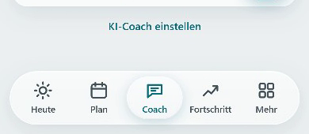
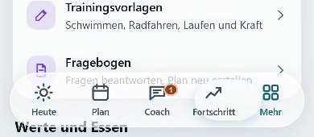
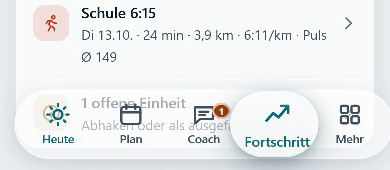
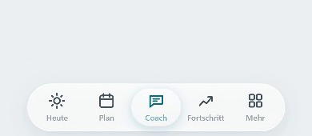

# Tab-Leiste: Stamio vs. iOS 26 (Auftrag 32)

Videos (390 × 844, Safari-Engine und Chromium): [tabbar-ios26-webkit.webm](tabbar-ios26-webkit.webm) · [tabbar-ios26-chromium.webm](tabbar-ios26-chromium.webm)
Ablauf im Video: Antippen (Heute → Mehr → Plan → Fortschritt → Heute), Halten + Ziehen über alle Tabs, schnelles Wischen, Halten auf „Coach“, Runterscrollen, Hochscrollen.
Neu aufnehmen: `RECORD=1 NAME=ios26 npx playwright test tests/e2e/tabbar-video.spec.ts` (mit `SLOW=4` in Zeitlupe).

| Ruhe | Tropfen beim Wechsel | Halten (ganze Leiste) | Runtergescrollt |
|---|---|---|---|
|  |  |  |  |

## Verhalten im Vergleich

| | iOS 26 (Apple Musik, Fotos, App Store) | Stamio |
|---|---|---|
| Glas | „Liquid Glass“: Inhalt dahinter unscharf, leicht gebrochen und aufgehellt, Glanzkante | Weichzeichner 18 px mit Sättigung/Helligkeit/Kontrast (Brechung angedeutet), Glanzkante oben, weiche Kante unten, dunkler Modus eigene Werte, „Transparenz reduzieren“ deckend |
| Drücken / Halten | Glas-Element wird beim Berühren größer, wirkt wie Gel, federt beim Loslassen zurück | Halten oder Ziehen: ganze Leiste wird 3,5 % größer, gedehnt von der Druckstelle aus (Gummiband rückt bei weitem Ziehen nach); Loslassen: Feder mit kleinem Überschwingen |
| Wechsel des Tabs | Auswahl gleitet wie ein Tropfen zum neuen Tab, dehnt sich in Bewegungsrichtung, federt nach | Eine Linse gleitet mit Feder (leichtes Überschwingen), dehnt sich mit der Geschwindigkeit (bis 24 %), schwillt beim Antippen kurz an |
| Runterscrollen | Leiste minimiert sich („tabBarMinimizeBehavior .onScrollDown“) | Leiste schrumpft auf 88 % (Feder-Kurve), Beschriftung blasser |
| Hochscrollen / Antippen | Leiste wird wieder groß | ebenso; auch beim Tab-Wechsel. Nur Scrollen mit Finger/Mausrad zählt, nicht automatisches Scrollen der App |
| Linsen | eine Auswahl | genau ein Linsen-Element (Test) |
| Flüssig | 60/120 fps | nur transform/scale, Gleiten und Zurückfedern als Web-Animation im Compositor; gemessen 16,0 ms je Bild beim Ziehen (60 fps) in WebKit und Chromium |
| Drehen | Leiste passt sich an | Linse und Leiste messen nach Drehen neu (Ruhelage, auch während einer Verformung) |
| Bewegung reduzieren | keine Feder-Effekte | keine Feder, kein Vergrößern, kein Schrumpfen, Linse springt direkt |

Unterschied: Echte Lichtbrechung (Verzerrung am Rand) kann Safari im Web nicht (kein Verzerrungs-Filter hinter Elementen); die Brechung ist mit Sättigung, Helligkeit und Glanz angedeutet. Beim kurzen Antippen bewegt sich nur der Tropfen, nicht die ganze Leiste – sonst müsste der Weichzeichner der Leiste in jedem Bild neu gerechnet werden (kostete in WebKit Bilder).

Quellen zum iOS-Verhalten: [Apple: tabBarMinimizeBehavior](https://developer.apple.com/tutorials/data/documentation/swiftui/view/tabbarminimizebehavior(_:).md), [Donny Wals: Tab bars on iOS 26 with Liquid Glass](https://www.donnywals.com/exploring-tab-bars-on-ios-26-with-liquid-glass/), [Create with Swift: Tab bar collapse while scrolling](https://www.createwithswift.com/making-the-tab-bar-collapse-while-scrolling/).
Tests: `tests/e2e/tabbar.spec.ts` (28 Fälle, Chromium + WebKit).
